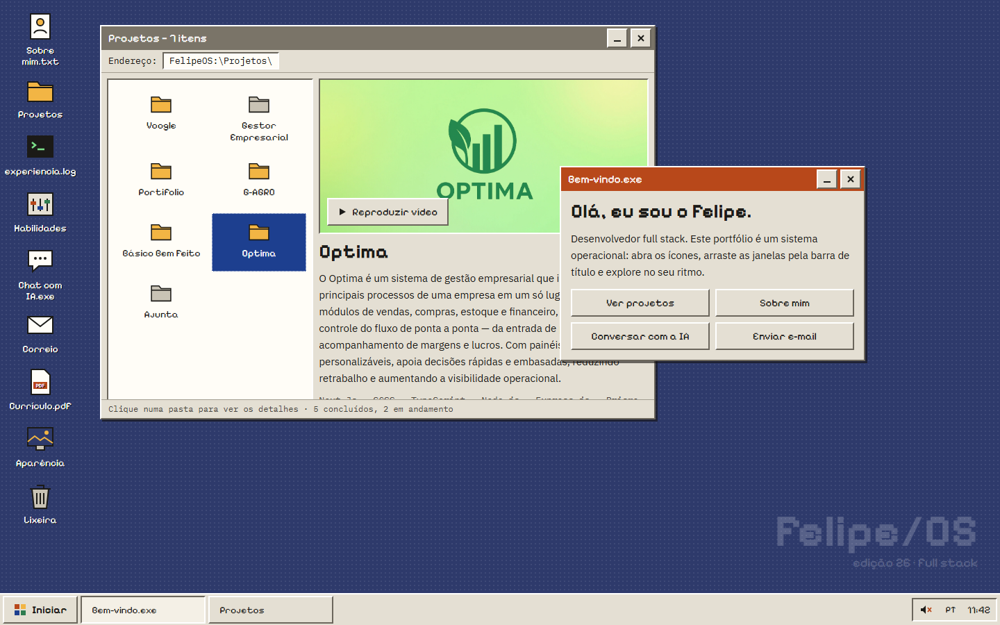

# Felipe/OS — Portfólio de Felipe Pereira

**🌐 [felipe-pereira.vercel.app](https://felipe-pereira.vercel.app/)**

Meu portfólio é um sistema operacional retrô que roda no navegador. Em vez de rolar uma página, o visitante explora uma área de trabalho: abre ícones, arrasta janelas e conversa com um assistente de IA que conhece meu trabalho.

## O que tem dentro

- **Projetos:** um explorador de arquivos com cada projeto, detalhes, tecnologias e um player para assistir aos vídeos de demonstração.
- **Chat com IA:** um assistente feito com LangChain e Gemini que responde perguntas sobre meus projetos e minha experiência.
- **Sobre mim, experiência e habilidades:** em janelas no estilo "Propriedades do sistema", terminal e painel de controle.
- **Correio:** para enviar uma mensagem direto do site.
- **Detalhes de sistema:** tela de inicialização, sons opcionais, papéis de parede e cores personalizáveis, menu Iniciar e versão em português e inglês.

Funciona no celular também: as janelas ocupam a tela inteira.

## Tecnologias

React, TypeScript e Vite no frontend · Python, FastAPI, LangChain e Gemini no backend · Vercel e Render para hospedagem.
