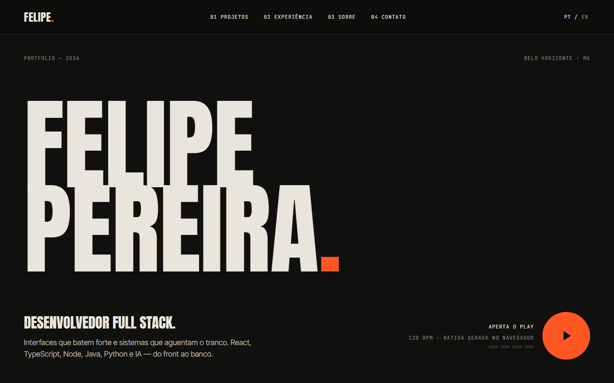

# Portfólio de Felipe Pereira

**🌐 [felipe-pereira.vercel.app](https://felipe-pereira.vercel.app/)**

Um portfólio com personalidade: tipografia grande em caixa alta, preto e osso como cores calmas e um laranja que faz todo o barulho. A ideia veio das músicas que eu gosto de ouvir. Dá até para apertar o play na capa e o site inteiro pulsa no ritmo de uma batida gerada pelo navegador.

## O que tem dentro

- **Projetos:** em grade, como capas de álbum, ou em lista. Cada projeto abre com descrição, tecnologias e vídeo de demonstração.
- **Experiência:** os slides passam para o lado conforme você rola a página.
- **Sobre:** um mosaico com fotos, prêmios e stack, que leva ao **Arquivo** com prêmios, certificados e papers.
- **Chat com IA:** um assistente feito com LangChain e Gemini que responde perguntas sobre meus projetos e minha experiência.
- **Detalhes:** cursor que cresce e inverte as cores sobre as imagens, versão em português e inglês e layout pensado para o celular.

## Tecnologias

React, TypeScript e Vite no frontend · Python, FastAPI, LangChain e Gemini no backend · Vercel e Render para hospedagem.
